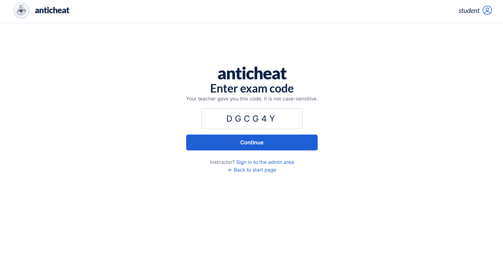
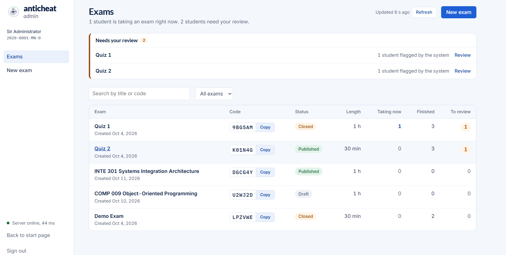
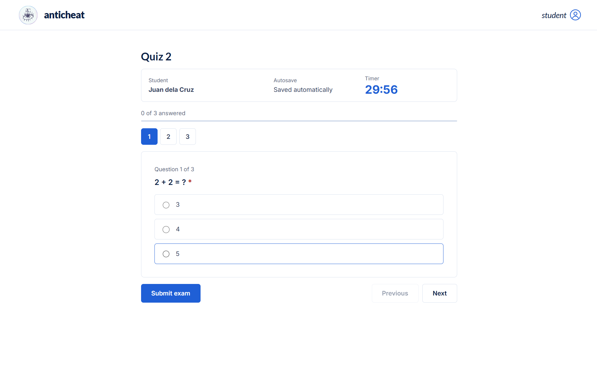
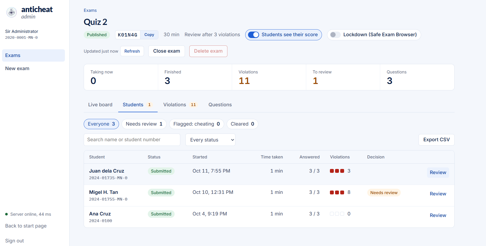
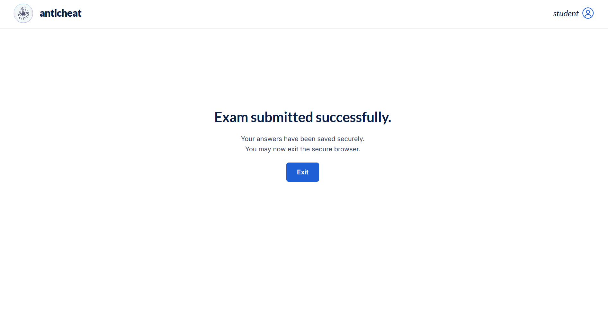
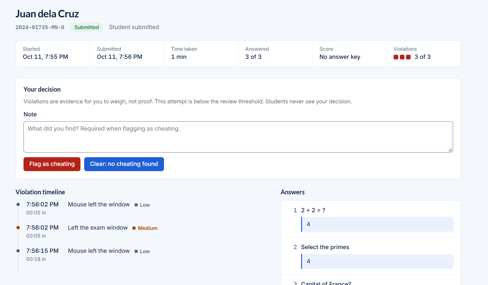

# 🛡️ AntiCheat

A web-based quiz system that replaces Google Forms for school exams. Students take the exam inside the app, the system **quietly records suspicious activity** (like switching tabs), and teachers **review the records and make the final decision**. For stricter exams, it can also work with **Safe Exam Browser** to lock the student's computer during the test.

> School project of Group 9, Polytechnic University of the Philippines (PUP), fulfilment for the course INTE 301 Systems Integration and Architecture.

---

## 📚 Project Resources

| Resource            | Link                                                 |
| ------------------- | ---------------------------------------------------- |
| 🎬 Video demo       | **TODO:** paste link                                 |
| 📄 Project document | **TODO:** paste PDF link (or `docs/<file>.pdf`)      |
| 💻 Source code      | https://github.com/migeltan/AntiCheat (`dev` branch) |
| 🔒 Lockdown guide   | [`docs/kiosk-setup.md`](docs/kiosk-setup.md)         |

---

## 📸 Screenshots

| Student side                                        | Teacher side                                       |
| --------------------------------------------------- | -------------------------------------------------- |
|  |  |
| _Entering the exam code_                            | _Dashboard: exams that need review_                |
|         |       |
| _Taking the exam_                                   | _Exam page with students and live board_           |
|               |        |
| _Result page_                                       | _Reviewing one student's activity_                 |

---

## 💡 About the Project

Google Forms is easy, but it can't tell a teacher whether a student left the exam to look something up. AntiCheat keeps the same simple flow (a teacher shares a code, students answer) and adds what Forms is missing: a built-in timer, autosave, automatic scoring, and a record of suspicious browser activity for the teacher to review.

**Important:** a flag is a review hint, **never proof** of cheating. The system only suggests, and the teacher decides.

---

## ✨ Features

**For students**

- Join with an exam code, enter name and student number
- Clear consent notice before the exam starts (tracking is never hidden)
- Timer, automatic saving of answers, and auto-submit when time is up
- Optional score page after submitting

**For teachers**

- Sign in with a teacher ID and password
- Create an exam by **importing an existing Google Form**
- Set answer keys: multiple choice and checkboxes are scored automatically, written answers are marked by the teacher
- Dashboard showing which exams and students need review
- Per-student activity log with a verdict: **Flagged** (with a note), **Cleared**, or **Pending**
- Exam settings: when to suggest a review, whether students see their score, whether Safe Exam Browser is required

---

## 🔍 How It Works

1. **Teacher** creates an exam (from a Google Form), sets the answer key, and publishes it.
2. **Students** enter the exam code, accept the consent notice, and take the exam.
3. **The system** silently logs activity such as switching tabs, leaving full screen, or copy/paste. Nothing is blocked and students are not warned or auto-submitted.
4. **Teacher** opens the results, checks the activity log for flagged students, and marks each one Flagged or Cleared.

**What gets recorded**

| Activity                | Level  |
| ----------------------- | ------ |
| Switched to another tab | Medium |
| Exam window lost focus  | Medium |
| Left full screen        | Medium |
| Pasted into the exam    | Medium |
| Copied from the exam    | Low    |
| Mouse left the window   | Low    |

A student is marked **needs review** once their medium/high activity reaches the limit the teacher set, or if there is any high-level activity.

**Optional lockdown with Safe Exam Browser (SEB)**

A website can't lock a computer, so for strict exams the teacher can turn on **Require Safe Exam Browser**. Students then must open the exam through SEB, which blocks other apps, other websites, shortcuts, and the clipboard. See [`docs/kiosk-setup.md`](docs/kiosk-setup.md) for details.

---

## 👥 Team

| Member                         | Role                    | What they did                                              |
| ------------------------------ | ----------------------- | ---------------------------------------------------------- |
| _Tan, Migel H._                | Backend / Data Lead     | _e.g. database, API, scoring, teacher login, activity log_ |
| _Baquing, Jaycee S._           | Form / Frontend Dev     | _e.g. student exam flow, timer, autosave, submission_      |
| _Panen, Alfred Nino Angelo D._ | Admin Dashboard + UI/UX | _e.g. teacher dashboard, review screens, overall design_   |
| _Orate, Francheska Gwen P._    | Kiosk / Lockdown Dev    | _e.g. Safe Exam Browser setup, activity tracking_          |
| _Aurel, Nicole Margaret R._    | QA / Integration + Docs | _e.g. testing, documentation, merging branches_            |

---

## 🧰 Tech Stack

| Layer           | Tool                        |
| --------------- | --------------------------- |
| Backend         | Laravel (PHP 8.3)           |
| Frontend        | React + Vite + React Router |
| Database        | MySQL                       |
| Lockdown        | Safe Exam Browser           |
| Version control | Git + GitHub                |

```
AntiCheat/
├── backend/    Laravel API
├── frontend/   React app (student + teacher screens)
└── docs/       Safe Exam Browser config and guide
```

---

## 🚀 Getting Started

**You need:** Laravel Herd (or PHP 8.3+), MySQL, Composer, Node.js + npm, and Git. Safe Exam Browser is optional (Windows only).

**1. Get the code**

```bash
git clone https://github.com/migeltan/AntiCheat.git
cd AntiCheat
git checkout dev
```

**2. Start the backend**

```bash
cd backend
composer install
cp .env.example .env          # Windows CMD: copy .env.example .env
# create an empty MySQL database named "anticheat" and put your DB password in .env
php artisan key:generate
php artisan migrate --seed
php artisan admin:create T001 "Your Name"    # asks for a password (8+ characters)
herd link                                    # or: php artisan serve
```

**3. Start the frontend** (in a new terminal)

```bash
cd frontend
npm install
cp .env.example .env          # set VITE_API_URL to your backend, no trailing /api
npm run dev
```

**4. Open the app**

- Students: http://localhost:5180/student
- Teachers: http://localhost:5180/admin (sign in with the account from step 2)

The seed creates a published **Demo Exam** you can try right away.

---

## ⚠️ Limitations

- Browser-based detection can't see a second device or a phone.
- Some signals (like the mouse leaving the window) are noisy, so treat them as hints.
- Student session links can be guessed, so this is built for classroom use, not high-stakes testing.
- Safe Exam Browser in this project has no quit password so the team could test easily. Set one before real use.

---

## 🛠️ Troubleshooting

| Problem                              | Fix                                                                         |
| ------------------------------------ | --------------------------------------------------------------------------- |
| App can't reach the backend          | Open `/api/ping` on the backend URL. Make sure `VITE_API_URL` matches it    |
| Can't sign in as teacher             | Run `php artisan admin:create <id> "<name>"` again (it resets the password) |
| Port 5180 already in use             | An old dev server is still running. Stop it first                           |
| "Must be taken in Safe Exam Browser" | Open the exam with `docs/anticheat.seb`, or turn off the SEB requirement    |
| Blank page after `git pull`          | Run `npm install` and `composer install`                                    |
